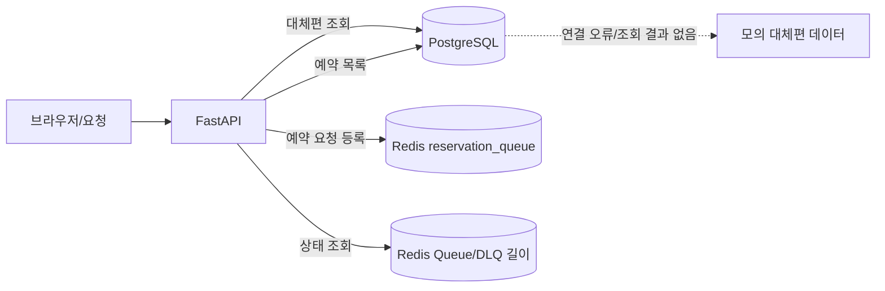

# SkyCare · 항공 지연·결항 대응 API

**FastAPI · PostgreSQL · Redis Queue**를 사용해 대체 항공편 조회, 예약 요청의 비동기 접수, 큐 상태 조회를 구현한 포트폴리오 프로젝트입니다.

KT AIVLE School에서 구상한 **지연·결항 확인 → 대체편 선택 → 예약/환불/대기 등 후속 조치**라는 셀프서비스 흐름 가운데, 공개 백엔드는 아래 범위를 구현합니다.

> **구현 범위 안내:** 이 저장소의 API는 실제 항공사 예약·취소·환불 시스템과 연동되지 않습니다. Redis Queue에 요청을 **등록**하지만 Worker의 자동 처리·DLQ 자동 이관·실제 항공권 발권은 공개 코드에 구현되어 있지 않습니다. 웹 미리보기는 가상 데이터를 사용하는 별도 정적 데모입니다.


## 코드 및 테스트

**실제 구현과 검증 연결**
- [`main.py`](main.py): 대체편 DB 조회·폴백, Redis `LPUSH` 요청 접수, Queue/DLQ `LLEN` 조회, 예약 목록 DB 조회
- [`tests/test_api_boundaries.py`](tests/test_api_boundaries.py): 실제 DB·Redis 없이 모의 객체로 정상 접수, Redis 장애 HTTP 500, DB 연결 장애 시 폴백 및 오류 분기를 검사
- [GitHub Actions](https://github.com/rlaqhfla0917-bit/skycare-disruption-api/actions/workflows/backend-tests.yml): `python -m unittest discover -s tests -v` 자동 실행 결과

**테스트 범위:** DB·Redis를 모의 객체로 대체한 예외 처리 테스트입니다. 실제 항공사 연동과 운영 환경 통합 테스트는 별도로 필요합니다. `queued`는 예약 확정이 아닌 접수 상태입니다.

**담당 영역:** 항공편 지연·결항 후속 사용자 흐름, FastAPI API 설계, 예외 처리 및 배포 구조 검토에 참여했습니다. 공개 코드는 데모 범위에 맞춰 정리했습니다.

---

## 1. 구현된 엔드포인트

| Method | Endpoint | 현재 코드 동작 |
| --- | --- | --- |
| GET | `/health` | 기본 상태값 `{"status":"ok"}` 반환. DB·Redis의 헬스체크는 아님 |
| GET | `/alternatives` | PostgreSQL의 `alternative_flights` 조회. 조회 결과가 없거나 연결 실패 시 사전 정의된 모의 데이터 제공 |
| POST | `/queue/reservations` | Pydantic 요청 검증 후 UUID 요청 ID를 만들고 Redis 리스트에 `LPUSH`. Redis 실패 시 HTTP 500 |
| GET | `/queue/status` | Redis의 Queue·DLQ 이름과 `LLEN` 값 조회. 실패 시 HTTP 500 |
| GET | `/reservations` | PostgreSQL `reservations` 테이블에서 최근 50건 조회. 연결 실패 시 HTTP 500 |

핵심 모듈: [`main.py`](main.py)

### 주요 요청 예시

```json
{
  "flight_id": "LCC912",
  "passenger_name": "홍길동",
  "passenger_phone": "010-0000-0000",
  "force_fail": false
}
```

`POST /queue/reservations`의 정상 응답은 `status: queued`, 생성된 `request_id`, 접수 메시지입니다. 이는 **예약 완료가 아닌 대기열 접수**입니다.

## 2. 데이터·예외 처리

- **PostgreSQL:** 대체 항공편 및 예약 요청 상태 데이터 구조. `psycopg2` 조회 결과를 JSON으로 반환
- **Redis:** `QUEUE_NAME=reservation_queue`, `DLQ_NAME=reservation_dlq` 이름을 구분. 현재 API는 요청 등록과 두 목록의 길이 조회를 지원
- **Fallback:** `/alternatives`에서 DB 연결 실패 또는 데이터 부재 시 데모용 `FALLBACK_ALTERNATIVES` 사용. **실제 운항 정보가 아닙니다**
- **Pydantic:** 예약 요청 필수 필드 형식 검증
- **오류 처리:** Redis 등록 실패, 상태 조회 실패, DB 예약 목록 조회 실패를 HTTP 500으로 반환



**미구현 범위:** 항공사 예약·환불 API 실제 호출, Queue 소비 Worker, 작업 재시도 정책, DLQ 자동 이관, 실시간 항공사 데이터 수집 및 최종 예약 확정.

## 3. 웹 미리보기와 코드의 차이

- [정적 UI 시연](https://rlaqhfla0917-bit.github.io/skycare-disruption-api/) — `docs/index.html`, 가상 항공편과 브라우저 저장소 사용. 실제 API 서버 아님
- [웹 시연 안내](docs/README.md)
- 실제 API 테스트: 로컬에서 FastAPI 서버를 실행해 `http://127.0.0.1:8000/docs` 접근
- [프로젝트 발표자료](presentation.pdf) · [시연 영상](skycare_demo.mp4)

## 4. 로컬 실행

Python 3.10 이상, Redis 서버와 PostgreSQL을 준비합니다. 외부 서비스가 없으면 일부 API는 오류 또는 모의 데이터로 응답할 수 있습니다.

```bash
git clone https://github.com/rlaqhfla0917-bit/skycare-disruption-api.git
cd skycare-disruption-api
python -m venv .venv
# Windows: .venv\\Scripts\\activate
# macOS/Linux: source .venv/bin/activate
pip install -r requirements.txt
uvicorn main:app --reload
```

환경변수 예시:

```env
REDIS_HOST=localhost
REDIS_PORT=6379
QUEUE_NAME=reservation_queue
DLQ_NAME=reservation_dlq
DB_HOST=localhost
DB_NAME=postgres
DB_USER=postgres
DB_PASSWORD=your_local_password
DB_PORT=5432
```

> 비밀번호·API 키·개인정보를 커밋하지 마세요. 저장된 예시 데이터는 가상 정보로 취급합니다.

## 5. 검증 시나리오와 후속 과제

현재 소스에서 확인 가능한 검증 포인트는 `/health` 기본 응답, 대체편 DB 실패 시 폴백, Redis 요청 등록의 예외, Queue/DLQ 길이, 예약 목록 DB 실패 응답입니다. **자동 테스트 결과는 위 GitHub Actions 링크에서 확인할 수 있습니다.**

개선 과제: Worker·재시도·DLQ 이관 테스트, DB/Redis 통합 테스트, 요청 중복 방지, 실제 예약 확정 상태 관리.

이 API는 가상 데이터를 사용하는 데모이며 실제 예약·결제에 사용할 수 없습니다.
